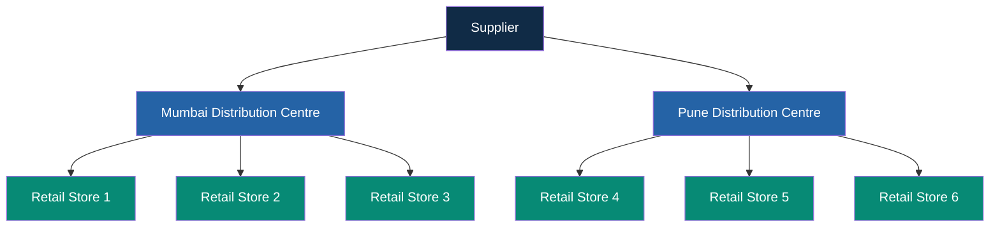

# 📦 InventOpt 2.0

### Enterprise Inventory Intelligence & MEIO Control Tower

**Decision Science · Supply Chain Analytics · Inventory Optimization · Strategic Planning**

[](https://inventopt-control-tower.streamlit.app/)
[](https://github.com/Vikrantthenge/Apps)
[](https://www.linkedin.com/in/vthenge)

---

## 🎯 Project Overview

**InventOpt 2.0** is an interactive inventory intelligence and decision-support platform designed to demonstrate how analytics can support retail inventory planning, supply chain visibility, risk monitoring and strategic business decisions.

The application combines demand forecasting, a simplified Multi-Echelon Inventory Optimization (MEIO) model, safety-stock planning and executive dashboards within a centralized Inventory Control Tower.

It helps stakeholders explore the balance between inventory availability, service levels and inventory investment.

Built as an independent, cross-industry analytics portfolio project using synthetic retail data.

---

## 🛠️ Technology Stack


---

## 💼 Business Objectives

The application demonstrates how organizations can use analytics to:

- Monitor inventory performance across distribution centres and stores.
- Identify potential shortages and excess inventory.
- Forecast future product demand.
- Evaluate safety-stock requirements.
- Explore inventory pooling opportunities.
- Support replenishment decisions.
- Simulate long-range inventory investment requirements.
- Provide actionable insights for management and stakeholders.

---

## 🚀 Key Features

| Module | Business Function |
|---|---|
| 📊 Executive Overview | Inventory KPIs, risk monitoring and management insights |
| 📈 Demand Forecasting | Eight-week moving-average forecasting and WAPE validation |
| 🌐 MEIO Network | Two-echelon inventory analysis and demand pooling |
| 🛡️ Safety Stock Planning | Service-level and lead-time-based inventory buffers |
| 🔥 Inventory Risk Heatmap | Identification of below-target and excess inventory |
| 🎯 Long-Range Planning | Three-year demand and inventory investment scenarios |
| 📋 Action Centre | Rule-based replenishment and inventory recommendations |
| 📥 Reporting | Downloadable forecasts and inventory plans |

---

## 📊 Application Modules

### 1. Executive Inventory Control Tower

Provides centralized visibility into:

- Weekly demand forecast
- Recommended inventory investment
- Product-store combinations below target
- Distribution centre buffer pooling potential
- Inventory health distribution
- Inventory risk heatmaps
- Dynamic executive recommendations

### 2. Demand Forecasting

Uses an eight-week moving average to estimate future demand.

Capabilities include:

- Historical demand visualization
- Adjustable forecast horizon
- Rolling forecast backtesting
- Weighted Absolute Percentage Error (WAPE)
- Downloadable demand forecasts

### 3. Multi-Echelon Inventory Optimization (MEIO)

Demonstrates inventory planning across connected supply chain locations.

The model explores:

- Store-level safety stock
- Distribution centre safety buffers
- Independent versus pooled inventory buffers
- Demand variability
- Service-level assumptions
- Lead-time sensitivity

This is a simplified two-echelon planning model, not a production-grade MEIO optimization engine.

### 4. Long-Range Planning (LRP)

An interactive three-year scenario simulator for evaluating:

- Annual demand growth
- Future inventory requirements
- Indicative inventory investment
- Alternative business planning assumptions

### 5. Inventory Action Centre

Provides rule-based recommendations for management review:

| Inventory Status | Recommended Action |
|---|---|
| 🔴 Below Target | Review replenishment requirements |
| 🟢 On Target | Monitor inventory performance |
| 🟠 Above Target | Review stock transfers or order adjustments |

Recommendations support human decision-making and do not automatically execute inventory orders.

---

## 🌐 Supply Chain Network



*Illustrative supply chain network used for inventory planning.*

---

## 📂 Dataset Overview

The default application uses synthetic retail demand data.

| Attribute | Description |
|---|---|
| Data records | 3,120 |
| Historical periods | 104 weeks |
| Products | 5 |
| Distribution centres | 2 |
| Retail stores | 6 |
| Currency | Indian Rupees (INR) |
| Data source | Synthetic retail demonstration data |

### CSV Schema

| Column | Description |
|---|---|
| `date` | Weekly observation date |
| `sku` | Stock Keeping Unit / Product |
| `dc` | Distribution centre |
| `store` | Retail store |
| `demand` | Weekly product demand |
| `unit_cost` | Product unit cost in INR |

Users can upload their own compatible CSV files for scenario analysis. Complete weekly observations are recommended.

---

## 🧮 Analytical Methodology

The application incorporates:

- Eight-week moving-average demand forecasting
- Descriptive and predictive analytics
- Normal-approximation safety-stock calculations
- Demand variability analysis
- Distribution centre demand pooling
- Inventory variance and risk segmentation
- Three-year scenario modelling
- Rule-based decision support

### Safety Stock

The model uses a safety-stock approximation based on demand variability, lead time and target cycle service level.

$$SS = Z \times \sigma_d \times \sqrt{L}$$

Where:

- **SS:** Safety stock
- **Z:** Service-level factor
- **σd:** Standard deviation of weekly demand
- **L:** Lead time in weeks

The calculation assumes fixed lead times and a normal approximation of cumulative demand.

### Weighted Absolute Percentage Error (WAPE)

$$WAPE = \frac{\sum |Actual-Forecast|}{\sum |Actual|} \times 100$$

WAPE provides a measure of historical forecast error. It does not guarantee future forecasting accuracy.

---

## 🏢 Cross-Industry Applications

The analytical approaches demonstrated are relevant to:

| Industry | Potential Application |
|---|---|
| Retail | Stock availability and demand planning |
| FMCG | Distribution and replenishment planning |
| E-commerce | Warehouse inventory monitoring |
| Manufacturing | Materials and inventory forecasting |
| Logistics | Distribution network planning |
| Aviation | Spare-parts and consumables planning |
| Consulting | Operational decision support and scenario analysis |

---

## 🎯 Transferable Skills Demonstrated

- Decision Science
- Retail & Inventory Analytics
- Supply Chain Analytics
- Multi-Echelon Inventory Optimization (MEIO)
- Inventory Control Tower
- Demand Forecasting
- Safety Stock Planning
- Long-Range Planning (LRP)
- Performance Optimization
- Business Intelligence
- Executive KPI Reporting
- Risk and Exception Management
- Scenario Modelling
- Data-Driven Decision Support

---

## 📁 Repository Structure

```text
inventopt-control-tower/
│
├── app.py
├── model.py
├── retail_demand.csv
├── requirements.txt
└── README.md
```

---

## ⚙️ Run Locally

Install the required dependencies:

```bash
pip install -r requirements.txt
```

Launch the application:

```bash
streamlit run app.py
```

No paid API subscription or API key is required.

---

## ☁️ Cloud Deployment

The application can be deployed using Streamlit Community Cloud.

**Live Application:**

[Launch InventOpt 2.0](https://inventopt-control-tower.streamlit.app/)

---

## ⚠️ Data & Model Disclaimer

This application is an independent, self-directed analytics portfolio project.

- The default retail dataset is synthetic.
- Inventory quantities and stock positions are simulated.
- Business recommendations are rule-based.
- The MEIO model is a simplified two-echelon planning demonstration.
- Long-range projections depend on user-selected assumptions.
- No actual retail client outcomes, savings or operational improvements are claimed.

The application is intended to demonstrate analytical capabilities and support exploratory decision-making, not replace enterprise inventory management systems.

---

## 👨‍💻 About the Developer

### Vikrant Thenge

**Operations & Decision Analytics Leader**

Performance Optimization | Strategic Planning | Control Tower Operations | Applied Analytics

Operations and decision analytics professional with 18+ years of experience across operational leadership, service delivery, resource planning, vendor governance and performance optimization.

Combines operational expertise with Python, SQL, Power BI, Streamlit and analytical decision-support tools.

Focuses on applying operational experience to cross-industry business challenges through independent analytics projects.

[](mailto:vikrantthenge@outlook.com)
[](https://www.linkedin.com/in/vthenge)
[](https://github.com/Vikrantthenge)
[](https://github.com/Vikrantthenge/Apps)

---

**InventOpt 2.0 — Turning Inventory Data into Strategic Decisions.**

*Monitor · Forecast · Optimize · Plan*
